# Project 1: Network Security and Data Transmission

---

## 1. Introduction

This project was undertaken as part of the TechCrush Cybersecurity Internship Capstone. It focuses on designing and securing a company network, implementing network segmentation, performing network reconnaissance, analysing network traffic and demonstrating secure data transmission.

The practical work involved using Cisco Packet Tracer to design a segmented network and VirtualBox to establish a testing environment with Kali Linux and Ubuntu Server.

---

## 2. Project Objectives

The objectives of this project were to:

- Design a company network topology.
- Implement VLAN segmentation across different departments.
- Configure and test network connectivity.
- Identify exposed hosts, ports and services using Nmap.
- Capture and analyse network traffic using Wireshark.
- Demonstrate file encryption, secure transfer and integrity verification.

---

## 3. Tools and Technologies

| Tool| Purpose|
|---|---|
|Cisco Packet Tracer| Network topology design and VLAN configuration|
|VirtualBox| Virtual machine deployment|
|Kali Linux| Security testing workstation|
|Ubuntu Server| Target server|
|Nmap| Network reconnaissance and port scanning|
|Wireshark| Network traffic capture and analysis|
|OpenSSL| File encryption and decryption|
|SHA-256| File integrity verification|
|SSH/SCP| Secure remote access and file transfer|

---

## 4. Network Design and VLAN Segmentation

A company network was designed using Cisco Packet Tracer. The topology consisted of one router, two switches and eight PCs distributed across four departments.

Each department was assigned a separate VLAN.

Department| VLAN ID| Network Address
|---|---|---|
HR| 10| 192.168.10.0/24
Finance| 20| 192.168.20.0/24
IT| 30| 192.168.30.0/24
Sales| 40| 192.168.40.0/24

Each department had two PCs. Connectivity was tested between devices within the same VLAN, while communication between different VLANs was tested to verify isolation.

### 4.1 Network Topology

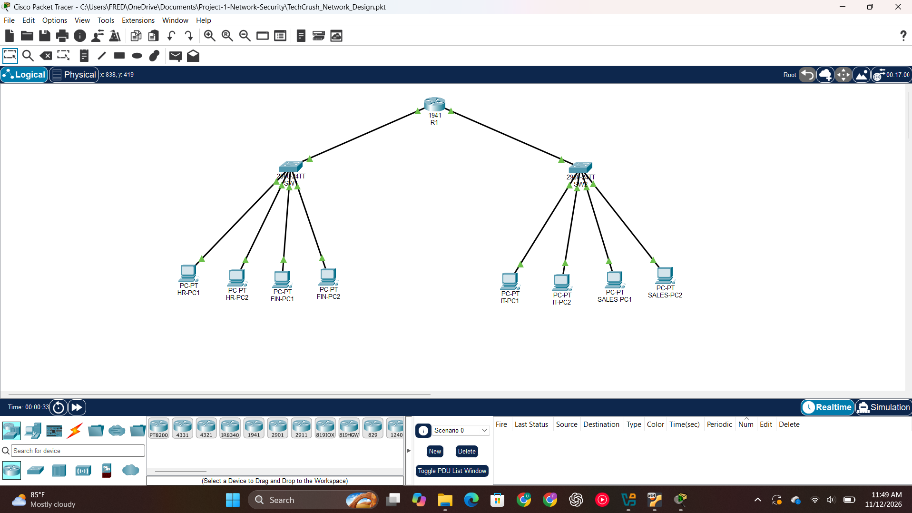

### 4.2 VLAN Configuration

The VLANs were configured on the two switches, with departmental ports assigned to their respective VLANs.

Switch 1

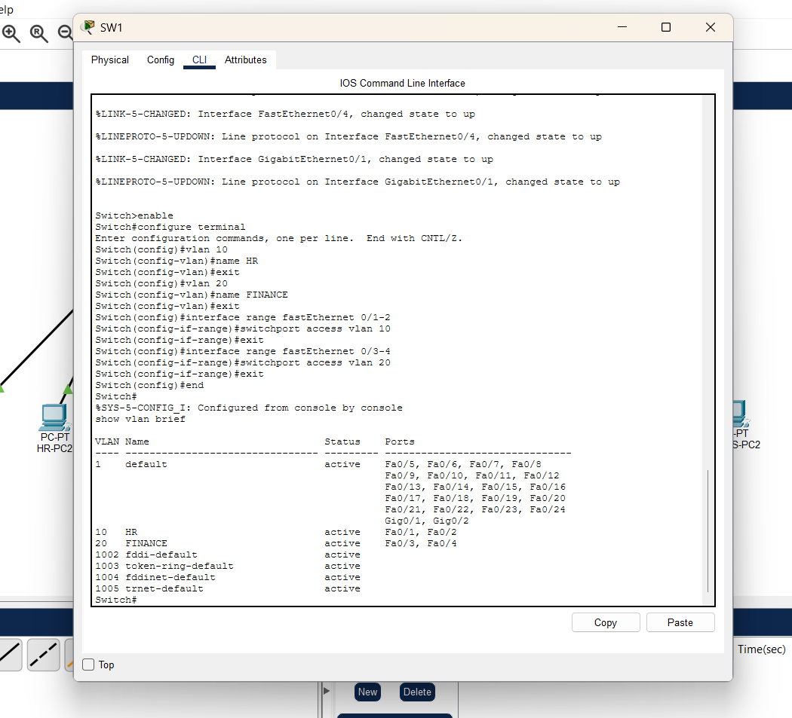

Switch 2

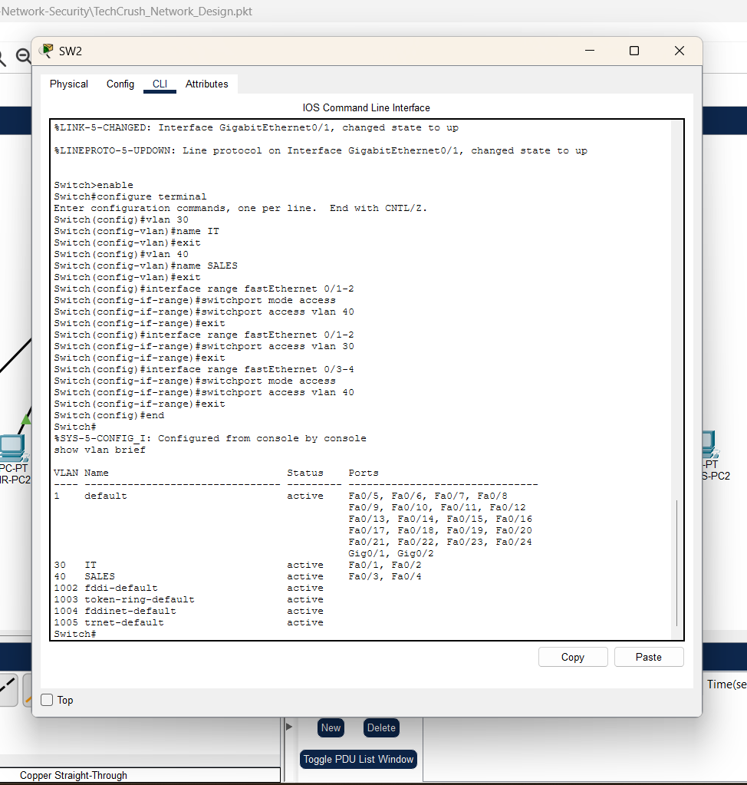

### 4.3 Inter-VLAN Isolation

An inter-VLAN connectivity test was performed from an HR workstation to a Finance workstation. The ping request timed out, demonstrating that communication between the tested VLANs was not permitted in the implemented configuration.

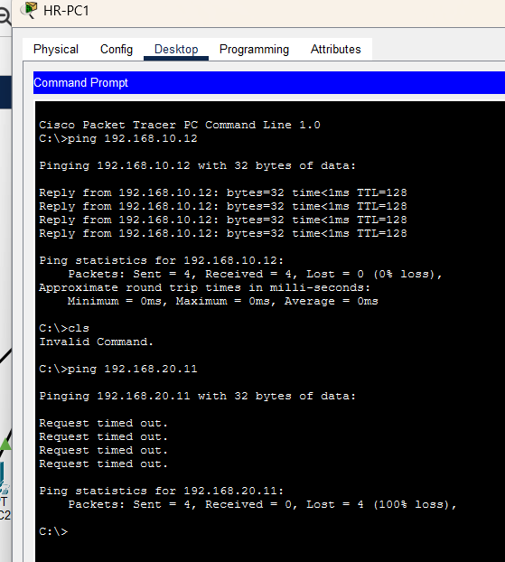

---

## 5. Virtual Lab Environment

A separate practical testing environment was established using VirtualBox.

Two virtual machines were configured:

- Kali Linux: Used as the security testing workstation.
- Ubuntu Server: Used as the target server.

Both virtual machines were connected through a dedicated VirtualBox Internal Network named "capstone-lab".

### 5.1 IP Address Configuration

Virtual Machine| Network Interface| IP Address
|---|---|---|
Kali Linux| eth1| 192.168.30.10/24
Ubuntu Server| enp0s8| 192.168.30.20/24

The two machines were able to communicate over the dedicated internal network. SSH was also enabled on Ubuntu Server to allow secure remote access from Kali Linux.

---

## 6. Network Reconnaissance Using Nmap

Nmap was used to perform network reconnaissance against the Ubuntu Server.

The following scanning activities were performed:

1. Host discovery.
2. TCP SYN port scanning.
3. Service and version detection.
4. Operating system detection.

### 6.1 Host Discovery

The host discovery scan confirmed that the Ubuntu Server was reachable on the network.

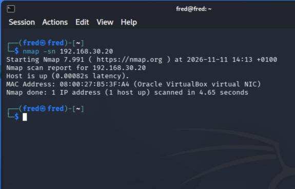

### 6.2 TCP Port Scanning

A TCP SYN scan was performed to identify open ports on the target server.

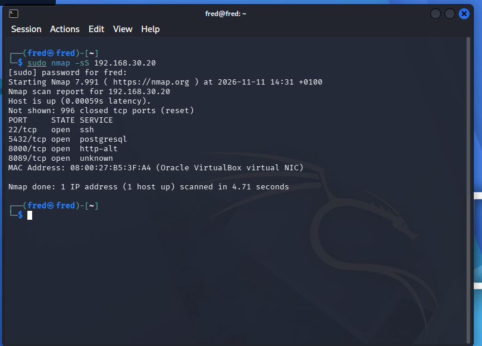

### 6.3 Service and Version Detection

The service detection scan identified the following open ports and services:

Port| Service
|---|---|
22| OpenSSH
5432| PostgreSQL
8000| Splunkd HTTP service
8089| Splunkd

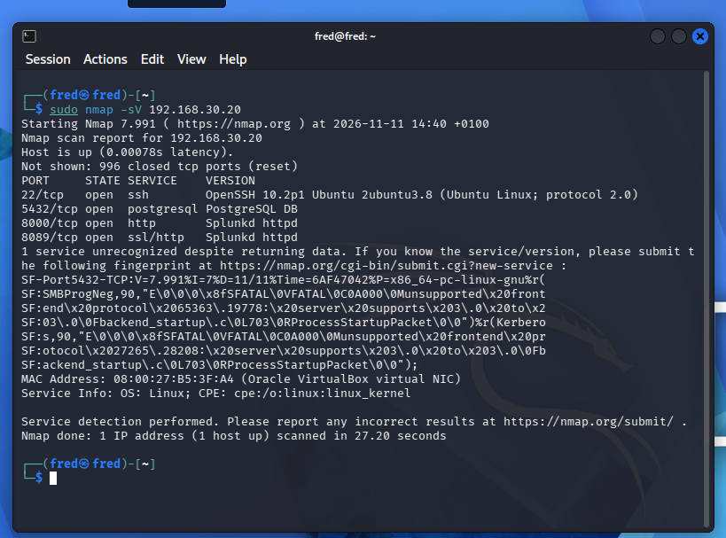

### 6.4 Operating System Detection

An operating system detection scan was performed. However, Nmap did not return a definitive operating system match.

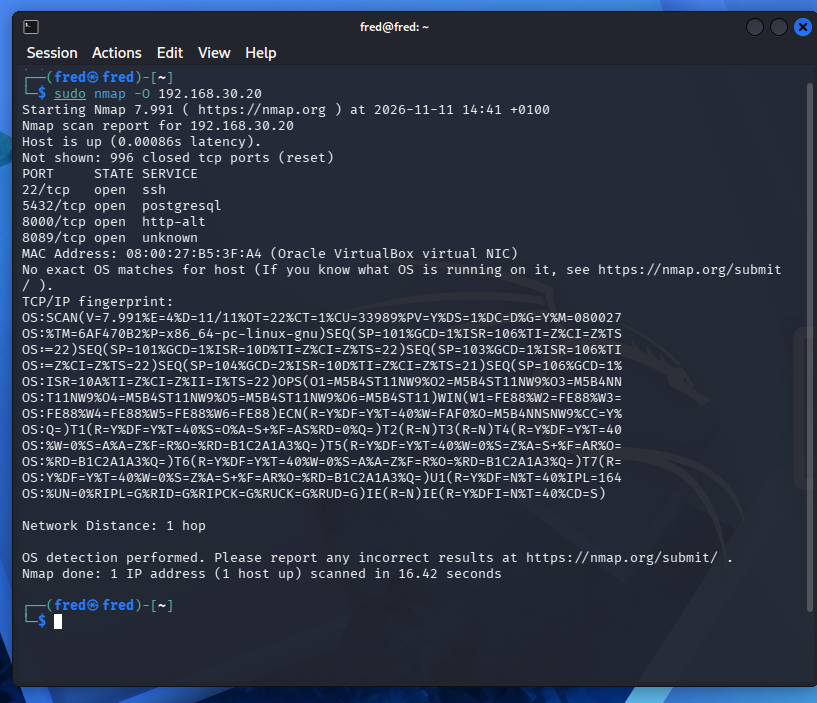

---

## 7. Network Traffic Analysis Using Wireshark

Wireshark was used to capture and analyse traffic generated during communication between Kali Linux and Ubuntu Server.

Three protocols were examined: ICMP, HTTP and SSH.

### 7.1 ICMP Traffic Analysis

ICMP packets were captured while performing connectivity tests between the two virtual machines.

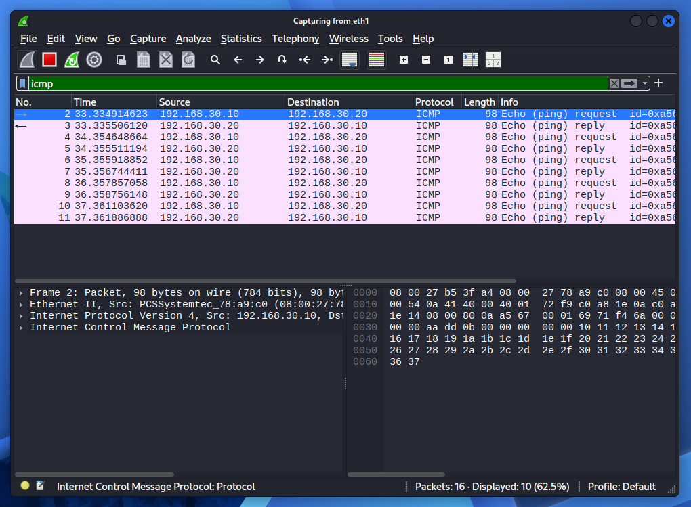

### 7.2 HTTP Traffic Analysis

A temporary Python HTTP server was started on Ubuntu Server. A text file was requested from Kali Linux using HTTP.

Wireshark was used to inspect the communication. The captured HTTP request and response demonstrated that the transferred content was readable in plaintext.

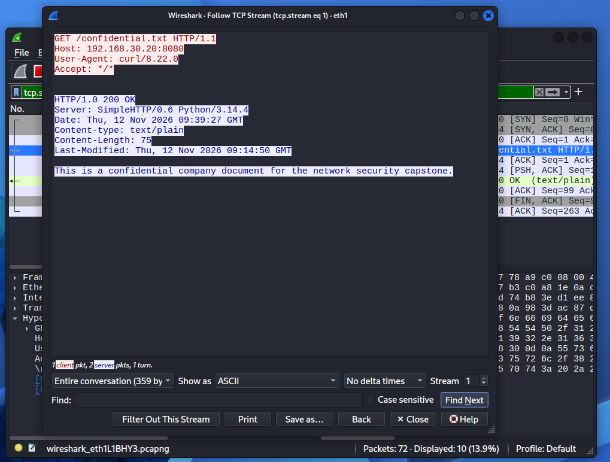

### 7.3 SSH Traffic Analysis

SSH traffic was captured during secure communication between Kali Linux and Ubuntu Server.

The inspection showed SSH protocol negotiation and encrypted packet exchange.

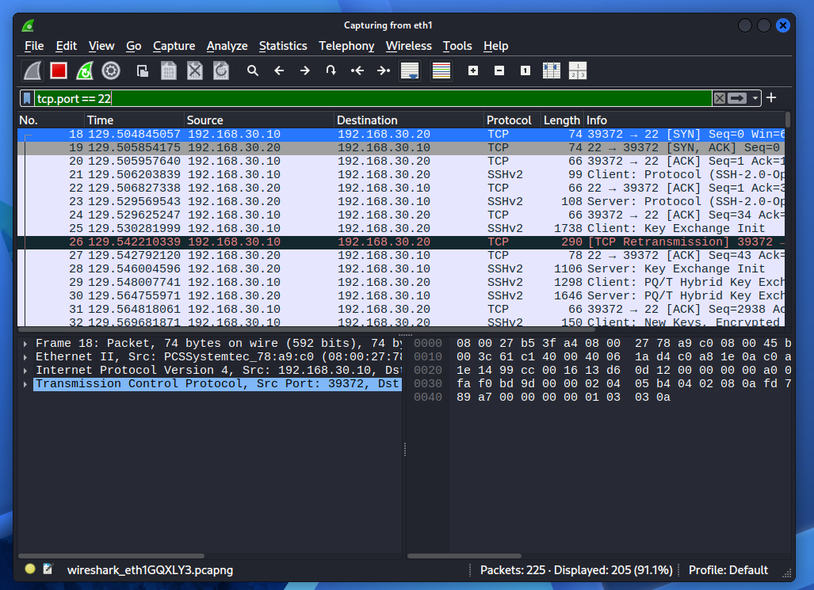

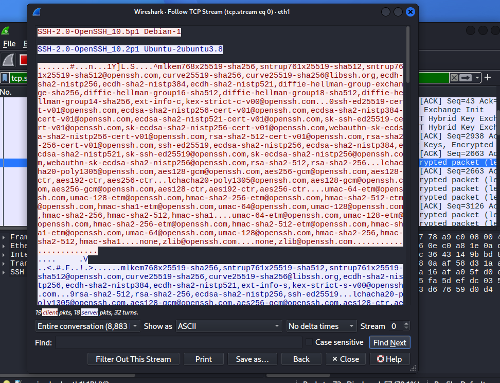

The packet capture file is available in this folder:

[Project 1 Data Transmission PCAP](Wireshark-Evidence/project1-data-transmission.pcapng)

---

## 8. File Encryption and Integrity Verification

OpenSSL was used to encrypt a confidential text file using AES-256-CBC.

The practical exercise involved the following steps:

1. Creating a confidential text file.
2. Generating its SHA-256 hash.
3. Encrypting the file using OpenSSL.
4. Generating the hash of the encrypted file.
5. Transferring the original and encrypted files to Ubuntu Server using SCP over SSH.
6. Verifying the transferred files using SHA-256.
7. Decrypting the encrypted file on Ubuntu Server.
8. Comparing the decrypted file's hash with the original file's hash.

The original and decrypted files produced matching SHA-256 hashes, confirming that their contents were identical.

Note: SCP uses SSH for transport encryption. The OpenSSL exercise separately demonstrated file-level encryption. The original file transferred through SCP was therefore protected in transit by SSH.

### 8.1 Original File Hash

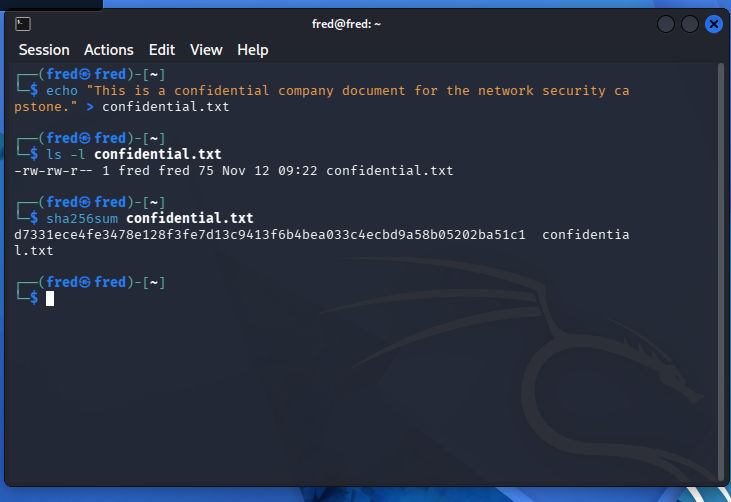

### 8.2 Original and Encrypted Hash Comparison

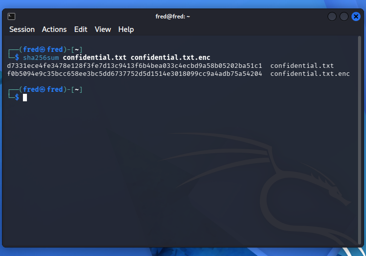

### 8.3 File Integrity Verification on Ubuntu

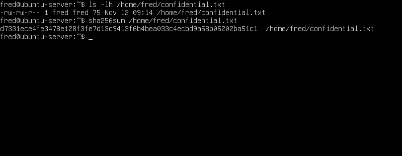

### 8.4 Encrypted File Transfer Verification

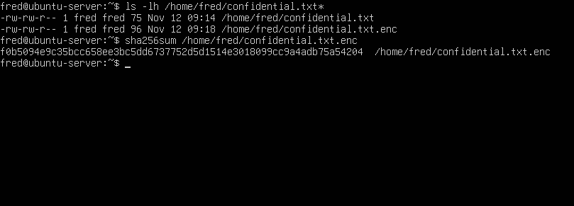

### 8.5 Decryption and Integrity Verification

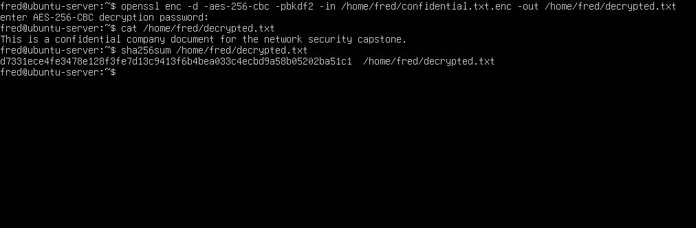

---

## 9. Security Recommendations

Based on the practical activities, the following security recommendations were identified:

- Implement network segmentation to separate departmental systems.
- Restrict unnecessary communication between network segments.
- Use SSH key-based authentication where appropriate.
- Prefer secure protocols such as HTTPS and SSH when transmitting sensitive information.
- Monitor network traffic for suspicious activities.
- Regularly update server software and operating systems.
- Verify file integrity using cryptographic hashing.

---

## 10. Key Learning Outcomes

This project strengthened my practical understanding of:

- Network topology design and configuration.
- VLAN implementation and network segmentation.
- Network reconnaissance and service enumeration.
- Packet capture and network traffic analysis.
- Secure remote access and file transfer.
- File encryption and decryption.
- SHA-256 hashing and file integrity verification.
- Practical security testing in a virtual lab environment.

---

## 11. Project Structure

The project evidence is organised into the following folders:

- Packet-Tracer: Network topology, VLAN configurations and isolation testing.
- Nmap-Scans: Host discovery, port scanning, service detection and OS detection.
- Wireshark-Evidence: Traffic analysis screenshots and PCAP capture.
- Encryption-and-Hashing: Encryption, hashing, file transfer and integrity verification.
- Network-Connectivity: Connectivity and SSH testing evidence.

---

Programme: TechCrush Cybersecurity Internship

Capstone Project: Network Security and Data Transmission
